# improveTaskOfEnginner 仕様書

エンジニア個人の日々の業務を**俯瞰して管理**し、タスク・集中・日報・ナレッジの摩擦を減らす Web アプリの仕様をまとめたもの。

| 項目             | 内容                                                                                                             |
| ---------------- | ---------------------------------------------------------------------------------------------------------------- |
| 対象             | `main` ブランチ(2026-10-22 時点)                                                                                 |
| リポジトリ       | `choryoh3/improveTaskOfEnginner`(public)                                                                         |
| 画面のキャプチャ | Playwright(Chrome)で取得した本番ビルドの画面。詳細は「[12. 付録](#12-付録キャプチャ)」                           |
| 関連ドキュメント | [architecture.md](architecture.md)(設計)/ [deploy.md](deploy.md)(デプロイ手順)/ [roadmap.md](roadmap.md)(拡張案) |

> **この文書の読み方**: 2 章は「GitHub・Vercel・Supabase がどうつながるか」を図でまとめている。
> 画面の仕様は 4 章、データは 6 章、API は 7 章。

## 目次

1. [概要](#1-概要)
2. [システム構成と外部サービスの関係](#2-システム構成と外部サービスの関係)
3. [画面一覧と遷移](#3-画面一覧と遷移)
4. [画面仕様](#4-画面仕様)
5. [横断機能の仕様](#5-横断機能の仕様)
6. [データモデル](#6-データモデル)
7. [API 仕様](#7-api-仕様)
8. [業務ルールと計算定義](#8-業務ルールと計算定義)
9. [認証・認可・セキュリティ](#9-認証認可セキュリティ)
10. [非機能要件](#10-非機能要件)
11. [テストと品質](#11-テストと品質)
12. [付録(キャプチャ)](#12-付録キャプチャ)
13. [既知の制約・未対応](#13-既知の制約未対応)

---

## 1. 概要

### 1-1. 目的と利用者

- **目的**: 「毎日開きたくなる、俯瞰とキーボード操作に強いエンジニアのコックピット」。
- **利用者**: エンジニア個人。**1 ユーザー = 1 つのデータ空間**で、他のユーザーのデータは見えない。チーム共有の機能は無い。

### 1-2. 機能(MVP)

| #   | 機能                         | 画面        | 概要                                                                 |
| --- | ---------------------------- | ----------- | -------------------------------------------------------------------- |
| 1   | Overview(俯瞰)               | `/overview` | 領域別の進捗、今週の負荷、期限切れ・ブロック中、7 日分の集中時間     |
| 2   | Today                        | `/`         | 今日やること、今日の集中時間、「次にやること」を 1 件提示            |
| 3   | タスク管理                   | `/tasks`    | 作成・編集・完了・削除・並べ替え。領域・優先度・タグ・見積もり・期限 |
| 4   | クイックキャプチャ・パレット | 全画面      | `⌘/Ctrl + K` のコマンドパレット、`C` キーでの追加                    |
| 5   | フォーカスタイマー           | 全画面      | ポモドーロ。タスクに紐づけて集中時間を記録                           |
| 6   | 日報・週次レビューの自動生成 | `/reports`  | 完了タスクと集中時間から Markdown を生成。ワンクリックでコピー       |
| 7   | ナレッジ(スニペット)         | `/snippets` | コマンドやメモを保存・検索。コードブロックにコピーボタン             |

MVP の外にある拡張案は [roadmap.md](roadmap.md) に書く(実装しない)。

---

## 2. システム構成と外部サービスの関係

このアプリは **GitHub(ソースと CI)・Vercel(実行)・Supabase(認証とデータ)** の 3 つのサービスで成り立つ。

### 2-1. 全体像(コンテキスト図)

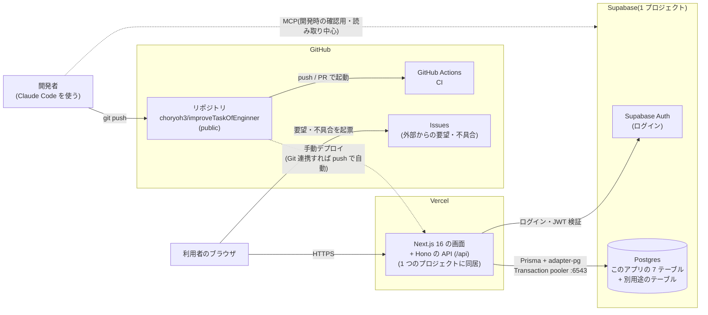

**凡例**: 実線は常時使う経路、点線は「操作したときだけ」または「任意」の経路。

### 2-2. 各サービスの役割

| サービス     | 役割                                 | このアプリでの具体的な内容                                                                                                                    | 設定する人 |
| ------------ | ------------------------------------ | --------------------------------------------------------------------------------------------------------------------------------------------- | ---------- |
| **GitHub**   | ソースの保管、CI、フィードバック窓口 | public リポジトリ。`main` / `develop` への push と PR で CI を実行。Issues にテンプレート(不具合報告・要望)あり                               | 開発者     |
| **Vercel**   | アプリの実行(画面 + API)             | Next.js と Hono を**同一プロジェクト**で動かす。Root Directory は `apps/web`。デプロイは手動                                                  | 開発者     |
| **Supabase** | ログイン(Auth)とデータ(Postgres)     | Auth はメール + パスワード。Postgres に 7 テーブル(RLS 有効)。別用途の `user_progress` テーブルが同じプロジェクトにある(このアプリは触れない) | 開発者     |
| **ローカル** | 開発・確認                           | SQLite(ファイル)+ Supabase Auth(本物)。環境変数は `apps/web/.env.local`                                                                       | 開発者     |

> **状況(2026-10-22 時点)**: GitHub と Supabase は稼働中。Vercel のプロジェクトは作成済みで、**デプロイ結果は本書の作成時点では確認していない**([13. 既知の制約](#13-既知の制約未対応))。

### 2-3. 環境ごとの構成の違い

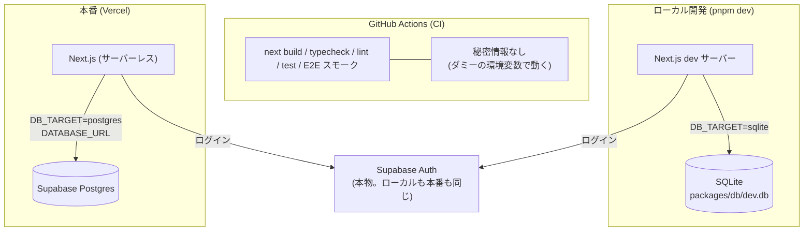

| 項目           | ローカル                      | CI                           | 本番(Vercel)                    |
| -------------- | ----------------------------- | ---------------------------- | ------------------------------- |
| DB             | SQLite(ファイル)              | 使わない(ビルドとテストのみ) | Supabase Postgres               |
| `DB_TARGET`    | `sqlite`(Postgres で確認も可) | 未設定                       | `postgres`                      |
| 認証           | Supabase Auth(本物)           | 使わない(ダミー値)           | Supabase Auth(本物)             |
| 環境変数の場所 | `apps/web/.env.local`         | ワークフローの `env`         | Vercel の Environment Variables |
| 秘密情報       | あり(DB パスワード)           | **なし**                     | あり(`DATABASE_URL`)。Sensitive |

DB の切り替えは、環境変数 `DB_TARGET` だけで行う。Prisma は schema ごとに接続先の種類が固定なので、1 つの原本から 2 種類を生成して使い分ける。

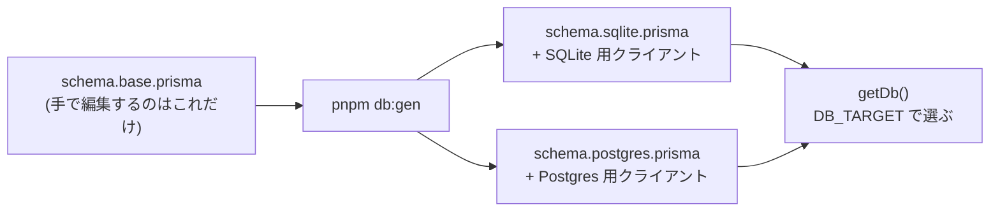

### 2-4. ソースからデプロイまでの流れ

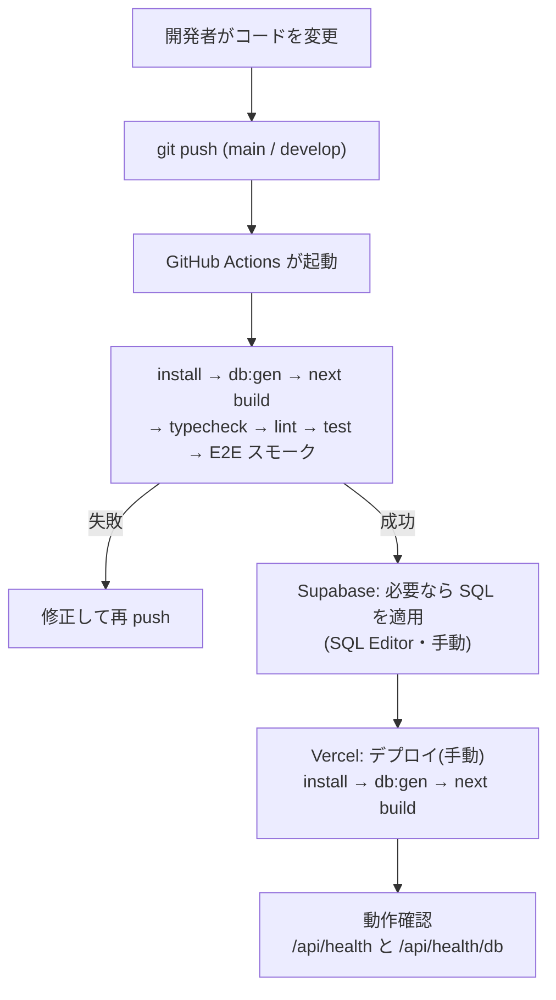

- **CI(GitHub Actions)は「検査」だけ**で、デプロイはしない。
- **DB のマイグレーションは、アプリのデプロイとは別の手動作業**。先に適用してからデプロイする([deploy.md](deploy.md))。
- Vercel のビルドは、`apps/web/vercel.json` のコマンド(`pnpm install` → `pnpm db:gen` → `next build`)で実行される。Prisma クライアントは git 管理外なので、ビルドのたびに生成する。

### 2-5. 環境変数の置き場所

| 変数                                   | ローカル(`.env.local`)     | Vercel       | GitHub Actions | 秘密か                     |
| -------------------------------------- | -------------------------- | ------------ | -------------- | -------------------------- |
| `NEXT_PUBLIC_SUPABASE_URL`             | 本物                       | 本物         | ダミー         | いいえ(ブラウザに配られる) |
| `NEXT_PUBLIC_SUPABASE_PUBLISHABLE_KEY` | 本物                       | 本物         | ダミー         | いいえ(公開用のキー)       |
| `DB_TARGET`                            | `sqlite` または `postgres` | `postgres`   | 未設定         | いいえ                     |
| `DATABASE_URL`                         | Postgres 確認時のみ        | **設定する** | 未設定         | **はい**(パスワードを含む) |
| `SQLITE_DATABASE_URL`                  | 絶対パスで設定             | 不要         | 未設定         | いいえ                     |
| `APP_TZ_OFFSET_MIN`                    | `540`                      | `540`        | 未設定         | いいえ                     |

- `NEXT_PUBLIC_` で始まる変数は**ブラウザに公開される**。秘密の値には付けない。
- `service_role` キーは、どこにも置かない(このアプリは使わない)。
- `.env.local` は git に入らない(`.gitignore` で除外)。ひな形は `.env.example`。

### 2-6. アプリの内部構成(パッケージ)

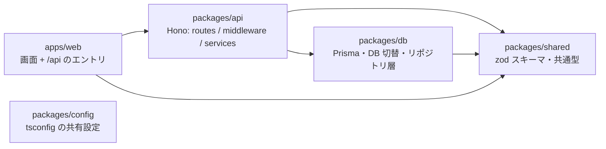

- 依存の向きは `apps/web → packages/api → packages/db / packages/shared`。**逆向きは禁止**。
- DB へ触れるのは**リポジトリ層だけ**。全クエリに `userId` が付く(9 章)。

### 2-7. リクエストの流れ(画面を開く・データを読む)

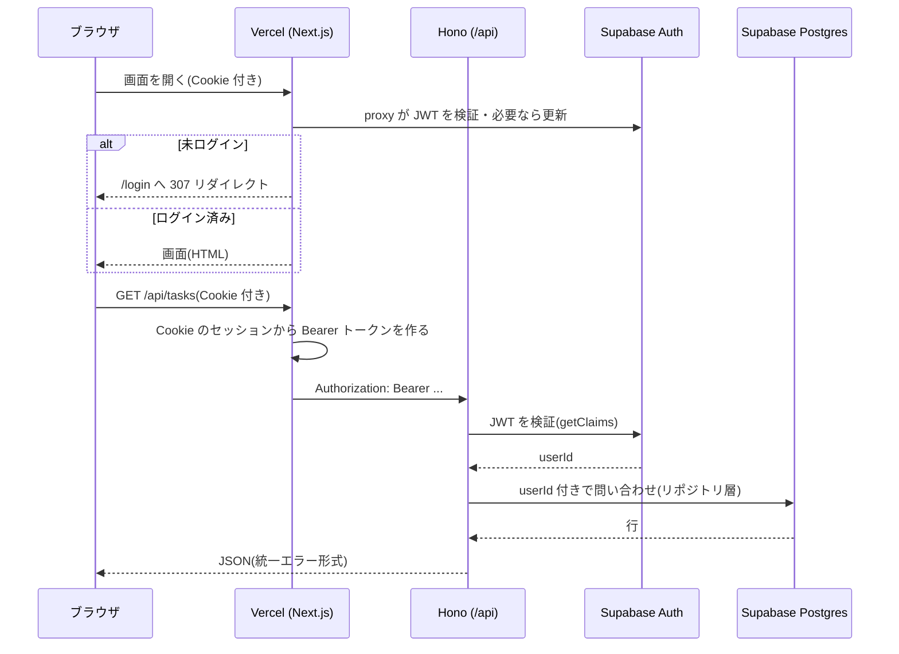

### 2-8. ログインの流れ(確認メール ON の場合)

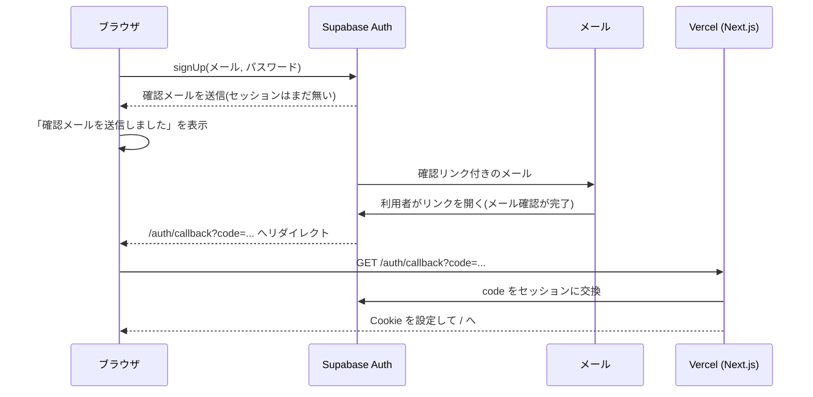

- Confirm email が **OFF** の場合は、`signUp` の直後にセッションが返り、そのまま `/` へ移動する。
- 現在の設定は **ON**(2026-10-22 時点)。標準のメール送信は 1 時間に数通までなので、公開するなら SMTP の設定が必要([deploy.md](deploy.md))。

### 2-9. 開発支援ツールとの関係

| ツール             | 用途                                                                 | 設定                      |
| ------------------ | -------------------------------------------------------------------- | ------------------------- |
| Supabase MCP       | 開発時に DB の状態を確認(読み取り中心)。本番への書き込みは確認が必要 | `.mcp.json`(`supabase`)   |
| Playwright MCP     | ブラウザで画面を確認し、キャプチャを取る                             | `.mcp.json`(`playwright`) |
| Claude Code の設定 | 方針・ルール・手順・専門担当・フック(誤操作の防止)                   | `CLAUDE.md` と `.claude/` |

---

## 3. 画面一覧と遷移

| 画面               | パス             | 認証                        | 概要                                 |
| ------------------ | ---------------- | --------------------------- | ------------------------------------ |
| ログイン           | `/login`         | 不要                        | ログイン・新規登録                   |
| メール確認の戻り先 | `/auth/callback` | 不要                        | `code` をセッションに交換して `/` へ |
| Today              | `/`              | 必要                        | 今日の状況と「次にやること」         |
| Overview           | `/overview`      | 必要                        | 領域別の進捗と集中時間の推移         |
| タスク             | `/tasks`         | 必要                        | 一覧・絞り込み・並べ替え             |
| 日報・レビュー     | `/reports`       | 必要                        | 日報・週次レビューの生成             |
| ナレッジ           | `/snippets`      | 必要                        | スニペットの保存・検索               |
| API                | `/api/*`         | 必要(`/api/health*` を除く) | 7 章を参照                           |

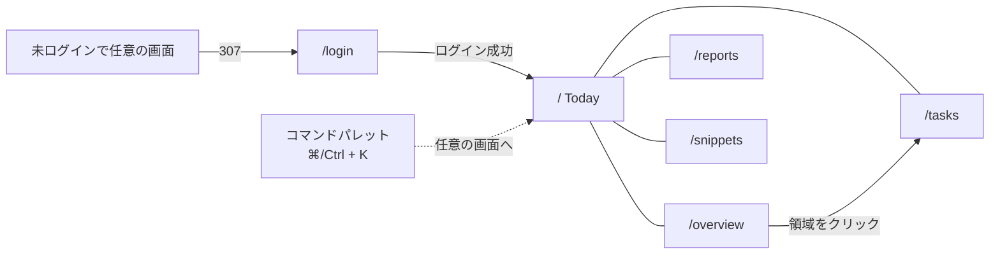

- **未ログインで保護された画面を開くと、`/login` へリダイレクト**(307)される。ログイン済みで `/login` を開くと `/` へ戻される。
- `/tasks?q=…&areaId=…` のように、クエリで検索語と領域を初期指定できる(コマンドパレットの「タスクを検索」、Overview の領域リンクが使う)。

---

## 4. 画面仕様

### 4-1. 共通レイアウト

**目的**: どの画面でも同じ場所から、検索・追加・フォーカス・移動ができるようにする。

| 要素               | 内容                                                                                                               |
| ------------------ | ------------------------------------------------------------------------------------------------------------------ |
| サイドバー(PC)     | ロゴ、ナビ 5 項目(Today / Overview / タスク / 日報・レビュー / ナレッジ)、「領域を管理」、ショートカットの案内     |
| ヘッダー           | 検索・追加・移動(パレットを開く)、フォーカス(ボタン、または計測中のタイマー)、「+ タスク」、テーマ切替、アカウント |
| アカウントメニュー | メールアドレスの表示と「ログアウト」                                                                               |
| 下部ナビ(モバイル) | Today / 俯瞰 / タスク / 日報 / ナレッジ の 5 項目                                                                  |
| スキップリンク     | キーボード利用者向けの「メインコンテンツへスキップ」                                                               |

- **PC とモバイルの切り替え**: 画面幅 1024px 以上でサイドバー、未満で下部ナビ。本文は最大幅 64rem(`max-w-5xl`)。
- **テーマ**: 既定は OS の設定に追従。ヘッダーのボタンでライト/ダークを切り替える。
- 計測中は、ヘッダーに**残り時間と終了ボタン**が出る(5 章)。

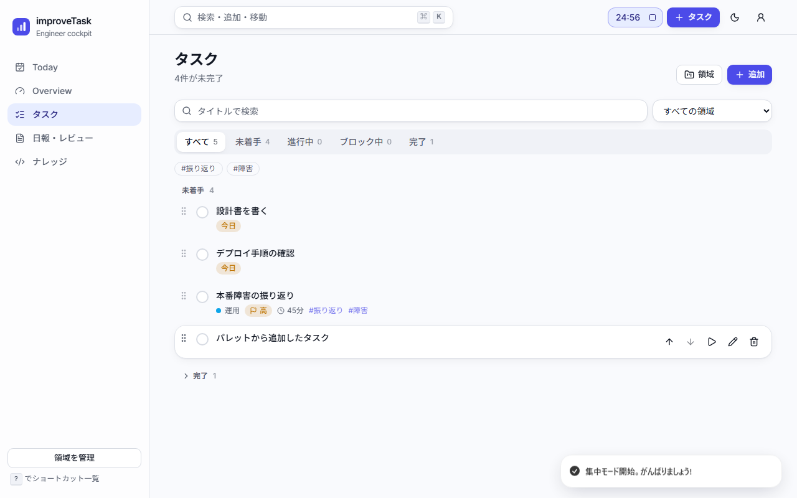

_図 4-1: 共通レイアウト(PC)。左がサイドバー、上がヘッダー。右上の `24:56` は計測中のタイマー。_

### 4-2. ログイン(`/login`)

**目的**: ログインと新規登録を 1 画面で行う。

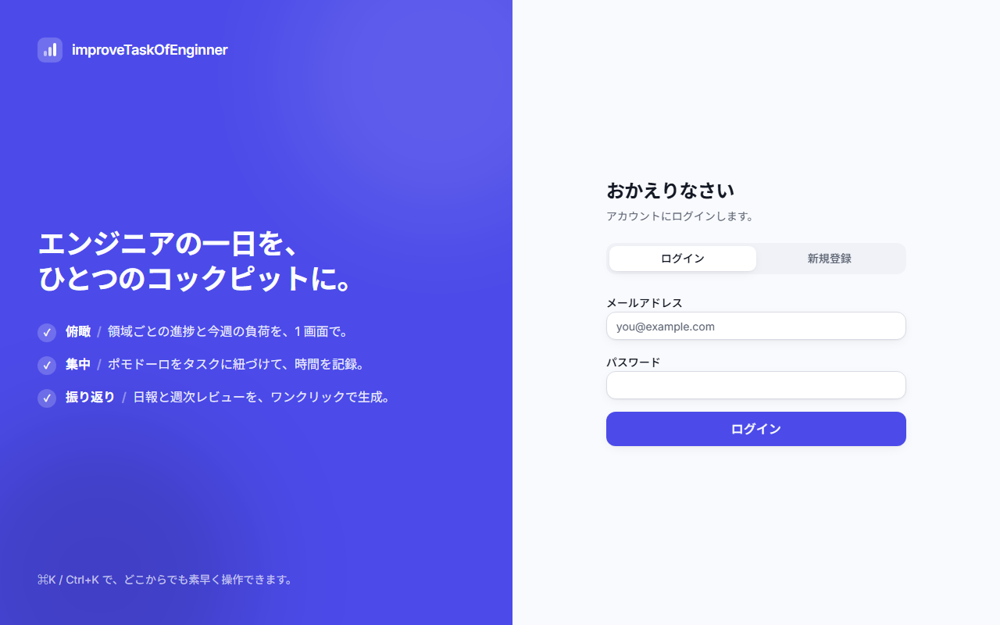

| 要素           | 内容                                                               |
| -------------- | ------------------------------------------------------------------ |
| ブランドパネル | PC のみ左に表示。キャッチコピーと 3 つの価値(俯瞰・集中・振り返り) |
| タブ           | 「ログイン」「新規登録」                                           |
| 入力欄         | メールアドレス、パスワード(8 文字以上)                             |
| ボタン         | 「ログイン」または「アカウントを作成」。送信中はスピナー           |

**状態とメッセージ**

| 状況                                           | 表示                                                                             |
| ---------------------------------------------- | -------------------------------------------------------------------------------- |
| 認証に成功(セッションあり)                     | `/` へ移動                                                                       |
| 新規登録でセッションが無い(確認メール ON)      | 「確認メールを送信しました」の画面。メールのリンクを開くと登録が完了             |
| ID・パスワードの誤り                           | 「メールアドレスまたはパスワードが正しくありません。」                           |
| 登録済みのメールアドレス                       | 「このメールアドレスはすでに登録されています。ログインしてください。」           |
| 新規登録が閉じている(`signup_disabled`)        | 「現在、新規登録は受け付けていません。」                                         |
| メール未確認(`email_not_confirmed`)            | 「メールアドレスの確認が済んでいません。届いたメールのリンクを開いてください。」 |
| メール送信の上限(`over_email_send_rate_limit`) | 「メールの送信回数の上限に達しました。しばらく待ってからやり直してください。」   |
| 使えないアドレス(`email_address_invalid`)      | 「このメールアドレスは利用できません。別のアドレスをお試しください。」           |
| 弱いパスワード(`weak_password`)                | 「パスワードが弱すぎます。より長く、推測されにくいものにしてください。」         |

### 4-3. Today(`/`)

**目的**: 開いてすぐ「今日、何をするか」が分かり、1 手で着手できる。

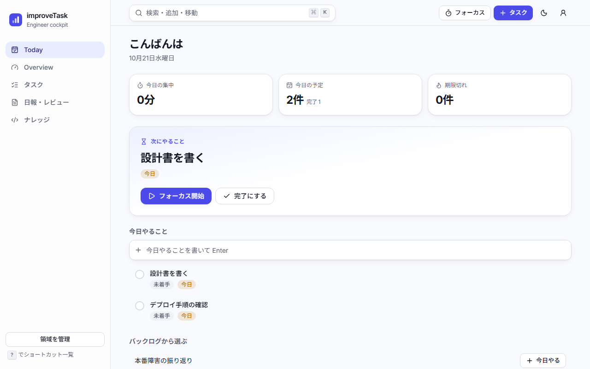

_図 4-3a: Today。「次にやること」のカードと、今日やること、バックログ。_

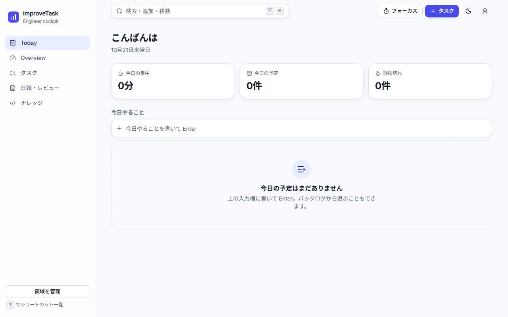

_図 4-3b: 今日の予定が無い状態。_

**構成(上から)**

1. **あいさつと日付**: 時間帯で変わる(5 時前「お疲れさまです」/ 11 時前「おはようございます」/ 18 時前「こんにちは」/ それ以降「こんばんは」)。
2. **統計カード 3 枚**: 今日の集中(分)/ 今日の予定(件数。完了した数を添える)/ 期限切れ(件数。1 件以上で赤)。
3. **次にやること**(計測中は、代わりに**フォーカスパネル**=大きなリングタイマー)。
4. **今日やること**: 入力欄 + 一覧。
5. **バックログから選ぶ**: 未着手の候補を最大 5 件。

**「次にやること」の選び方**(優先順位の高い順)

1. 進行中のタスク
2. 期限切れのタスク
3. 今日が期限のタスク
4. それ以外は、優先度の高い順、並び順の早い順

| 操作                     | 動作                                                                                   |
| ------------------------ | -------------------------------------------------------------------------------------- |
| 「フォーカス開始」       | 未着手なら**進行中**にしてから、そのタスクを選んだ状態でフォーカス開始ダイアログを開く |
| 「完了にする」           | 完了にする(「元に戻す」付きの通知)                                                     |
| タイトルをクリック       | 編集ダイアログ                                                                         |
| 入力欄に書いて Enter     | **期限が今日**のタスクとして、すぐ追加(楽観的更新)                                     |
| 「今日やる」(バックログ) | 期限を今日(23:59)に設定。今日やることに移る                                            |

- **今日やること**に出るのは、「進行中」「期限切れ」「今日が期限(未完了)」のタスク(重複は 1 件にまとめる)。
- 今日の予定がすべて片付くと、紙吹雪と「今日の予定はすべて完了です」を表示(その画面を開いている間に 0 件になったときだけ)。
- **空の状態**: 「今日の予定はまだありません」と、入力欄を促す文。
- 読み込み中は、スケルトンを表示。取得に失敗したら、エラーと「再試行」。

### 4-4. Overview(`/overview`)

**目的**: 領域ごとの進捗と、今週の負荷を 1 画面で俯瞰する。

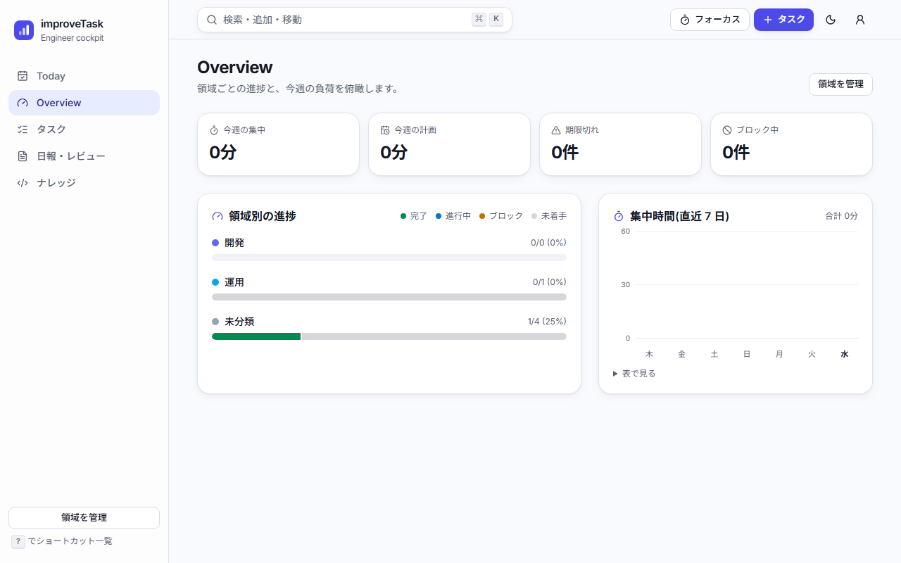

_図 4-4: Overview。撮影時のサンプルでは、集中時間が数秒しかなく、グラフのバーが 0 分で表示されている。_

| ブロック            | 内容                                                                                                                                               |
| ------------------- | -------------------------------------------------------------------------------------------------------------------------------------------------- |
| KPI 4 枚            | 今週の集中(計画があれば「計画 N」を添える)/ 今週の計画 / 期限切れ(1 件以上で赤)/ ブロック中(1 件以上で黄)                                          |
| 領域別の進捗        | 領域ごとに、積み上げの横棒(完了・進行中・ブロック・未着手)、「完了/全体(割合%)」、期限切れのバッジ。領域名をクリックすると、その領域のタスク一覧へ |
| 集中時間(直近 7 日) | 縦棒グラフ。今日の列は強調。各列にマウスを重ねる・フォーカスすると、日付と分数のツールチップ。「表で見る」で、同じ内容を表で表示                   |

- 領域に属さないタスクがあれば、「**未分類**」の行を末尾に追加する。
- グラフの縦軸は 0 / 中間 / 最大の 3 本。最大は、30 分刻みで切り上げ(最小 60)。
- **空の状態**: 「まだ集計するタスクがありません」と「領域を作る」ボタン。
- 色だけに頼らず、凡例(完了・進行中・ブロック・未着手)と数値を併記する。

### 4-5. タスク(`/tasks`)

**目的**: 全タスクを検索・絞り込み・並べ替えて管理する。

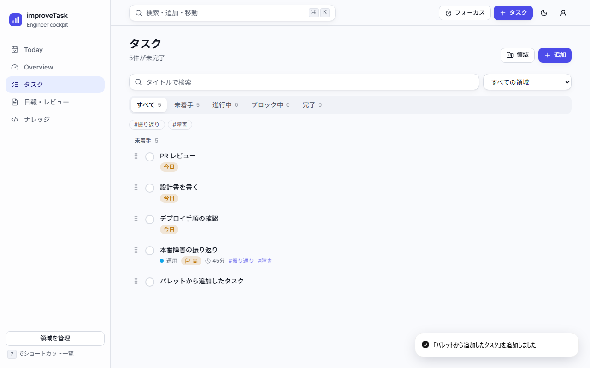

_図 4-5a: タスク一覧(「すべて」。未着手のグループ、完了は折りたたみ)。_

**構成**

| 要素     | 内容                                                                                                        |
| -------- | ----------------------------------------------------------------------------------------------------------- |
| ヘッダー | 「N 件が未完了」(未着手 + 進行中 + ブロック中)、「領域」(領域管理)、「追加」                                |
| 検索     | タイトルに含まれる語で検索(入力の 250ms 後に反映)                                                           |
| 領域     | 「すべての領域」または 1 つの領域                                                                           |
| 状態タブ | すべて / 未着手 / 進行中 / ブロック中 / 完了(件数つき。現在の検索・領域の結果に対する件数)                  |
| タグ     | 現在の結果に含まれるタグのチップ。クリックで絞り込み、もう一度で解除                                        |
| 一覧     | 「すべて」のとき、**進行中 → ブロック中 → 未着手 → 完了**の順にグループ化(完了は折りたたみ。クリックで開閉) |

**1 行の構成**: つまみ(並べ替え)、チェックボックス、タイトル、メタ情報(領域の色と名前、優先度「高」「緊急」、期限、見積もり、タグ)。

| 期限の表示     | 条件                     | 色   |
| -------------- | ------------------------ | ---- |
| `期限切れ M/D` | 期限を過ぎた(未完了)     | 赤   |
| `今日`         | 期限が今日               | 黄   |
| `明日`         | 期限が明日               | 通常 |
| `M/D`          | それ以外、または完了済み | 通常 |

**行の操作**(マウスを重ねる、またはフォーカスすると右に出る。モバイルでは常に表示)

| ボタン | 動作                                                       |
| ------ | ---------------------------------------------------------- |
| ↑ / ↓  | 同じグループの中で 1 つ上/下へ移動                         |
| ▶      | フォーカスを開始(そのタスクを選んだ状態でダイアログを開く) |
| 鉛筆   | 編集ダイアログ                                             |
| ごみ箱 | 確認のあと削除(楽観的更新。成功したら通知)                 |

- **チェックボックス**: 完了 ⇄ 未着手。完了にすると「完了しました」の通知に**「元に戻す」**が付き、押すと**直前の状態**に戻る。
- **並べ替え**: ドラッグ&ドロップ(同じグループ内)、または ↑ / ↓。前後の行の**中間の値**を並び順にする(端に置くときは ±1024)。
- 一度に読み込むのは最大 200 件。
- **空の状態**: タスクが無いときは「最初のタスクを追加しましょう」。絞り込みで 0 件のときは「条件に合うタスクがありません」と「条件をクリア」。

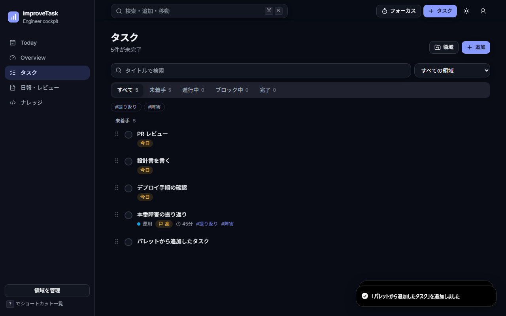

_図 4-5b: ダークテーマ。_

### 4-6. 日報・レビュー(`/reports`)

**目的**: 完了したタスクと集中時間から、日報・週次レビューを自動で作り、コピーして貼れるようにする。

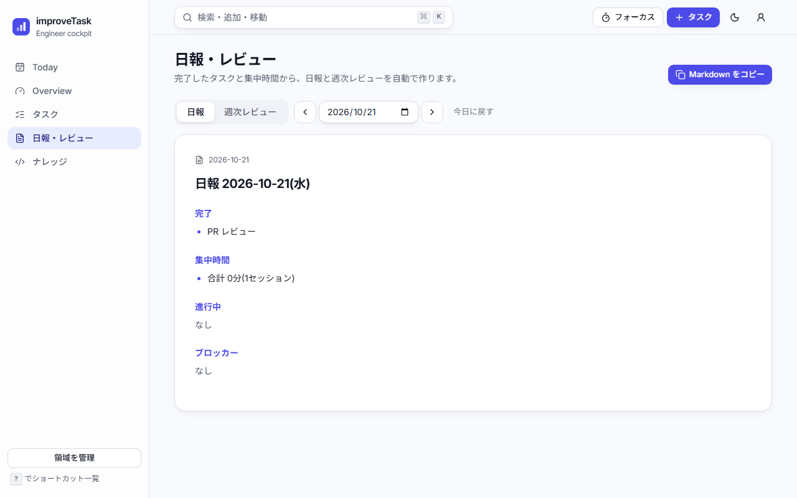

_図 4-6a: 日報。_

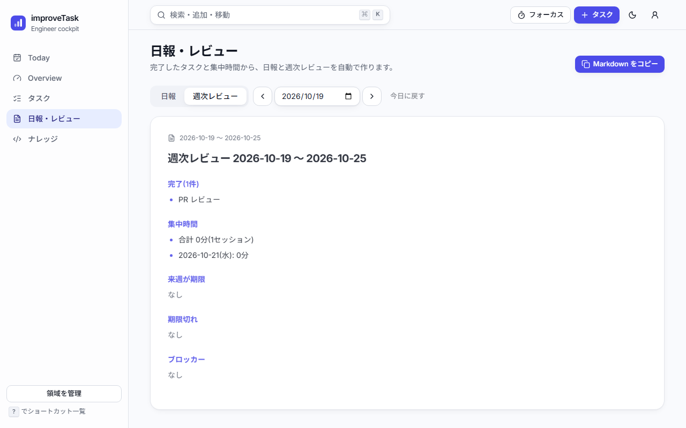

_図 4-6b: 週次レビュー(2026-10-19 〜 10-25)。_

| 要素                  | 内容                                                                                  |
| --------------------- | ------------------------------------------------------------------------------------- |
| タブ                  | 「日報」「週次レビュー」                                                              |
| 日付の操作            | ◀ ▶(日報は 1 日、週次は 1 週間ずつ)、日付入力(その日を含む期間を表示)、「今日に戻す」 |
| 「Markdown をコピー」 | 生成した Markdown をクリップボードへ(成功・失敗を通知)                                |
| 本文                  | 見出しと箇条書きだけを描画する簡易ビュー                                              |

**生成される内容**(項目が無いときは `- なし`)

| 種類 | セクション                                                                                                                                |
| ---- | ----------------------------------------------------------------------------------------------------------------------------------------- |
| 日報 | `# 日報 YYYY-MM-DD(曜)` / `## 完了`(`- [領域] タイトル(集中 N分)`)/ `## 集中時間`(`合計 N分(Mセッション)`)/ `## 進行中` / `## ブロッカー` |
| 週次 | `# 週次レビュー 開始日 〜 終了日` / `## 完了(N件)` / `## 集中時間`(合計と日別)/ `## 来週が期限`(翌 7 日)/ `## 期限切れ` / `## ブロッカー` |

- 週は**月曜始まり**。集中時間には**休憩を含めない**。
- 「進行中」「ブロッカー」は、期間に関係なく**現在の状態**を載せる。

### 4-7. ナレッジ(`/snippets`)

**目的**: 何度も調べるコマンドやメモを保存し、すぐ引き出してコピーする。

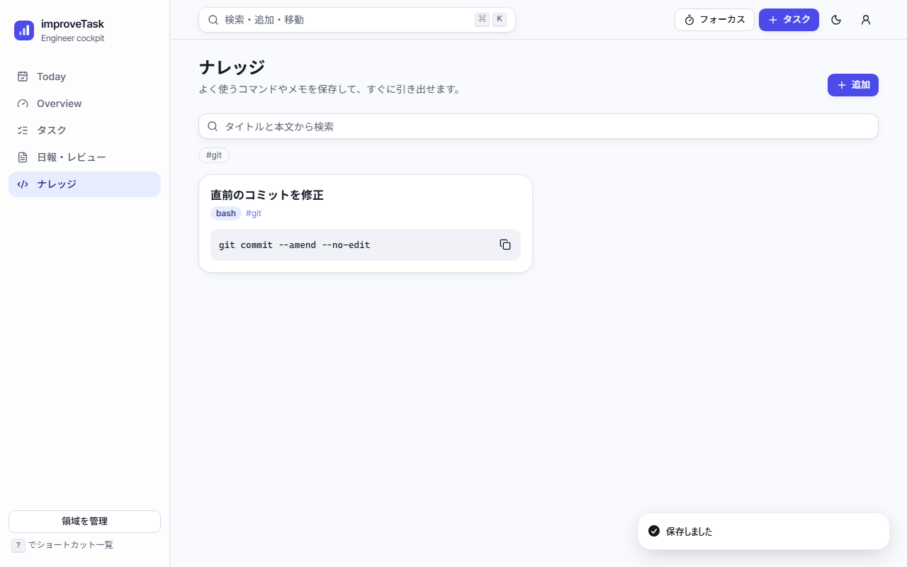

_図 4-7a: 一覧。コードブロックの右にコピーボタン。_

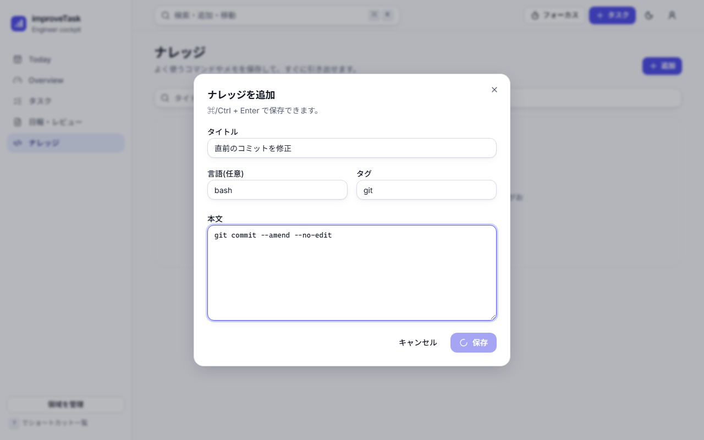

_図 4-7b: 追加ダイアログ(保存中)。_

| 要素       | 内容                                                                                                                  |
| ---------- | --------------------------------------------------------------------------------------------------------------------- |
| 検索       | タイトルと本文から検索(250ms 後に反映)                                                                                |
| タグ       | チップで絞り込み                                                                                                      |
| カード     | タイトル、言語のバッジ、タグ、コードブロック(高さを超えるとスクロール)、コピーボタン、編集・削除                      |
| ダイアログ | タイトル(必須)、言語(任意。`bash` `sql` `typescript` などの候補つき)、タグ、本文(必須。等幅)。`⌘/Ctrl + Enter` で保存 |

- 並びは**更新が新しい順**。一度に読み込むのは最大 200 件。
- コピーに成功するとアイコンがチェックに変わり、通知を表示。
- **空の状態**: 「最初のナレッジを保存しましょう」。

### 4-8. モバイル(幅 390px)

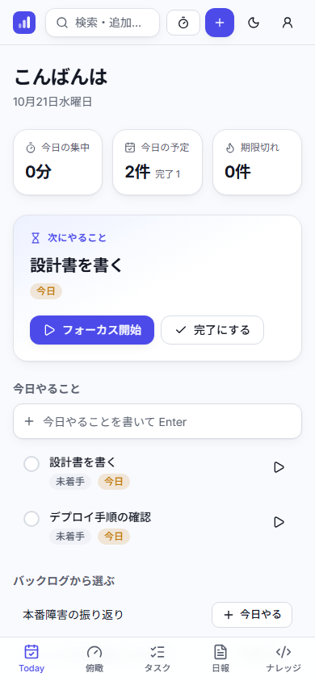
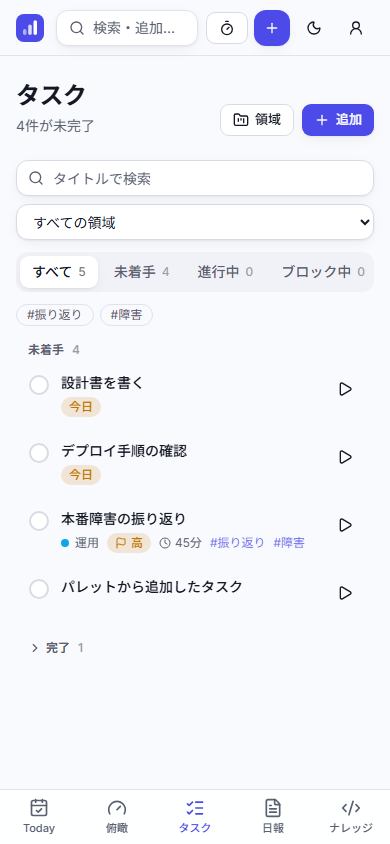
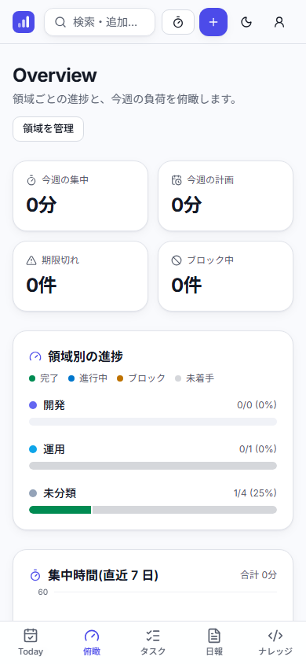

_図 4-8: 左から Today / タスク / Overview。下部ナビ(Today・俯瞰・タスク・日報・ナレッジ)が出る。_

- 横スクロールは出ない(確認済み)。
- 行の操作ボタンは、ホバーが無いため**常に表示**。並べ替えの ↑ / ↓ とごみ箱・鉛筆は、幅の都合で非表示(▶ は表示)。

### 4-9. ダークテーマ

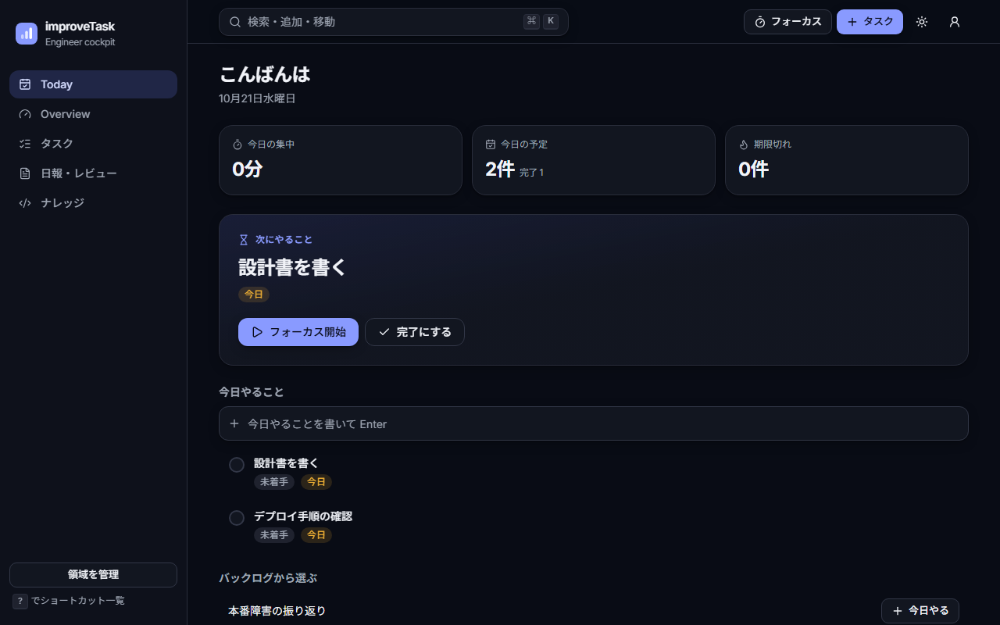
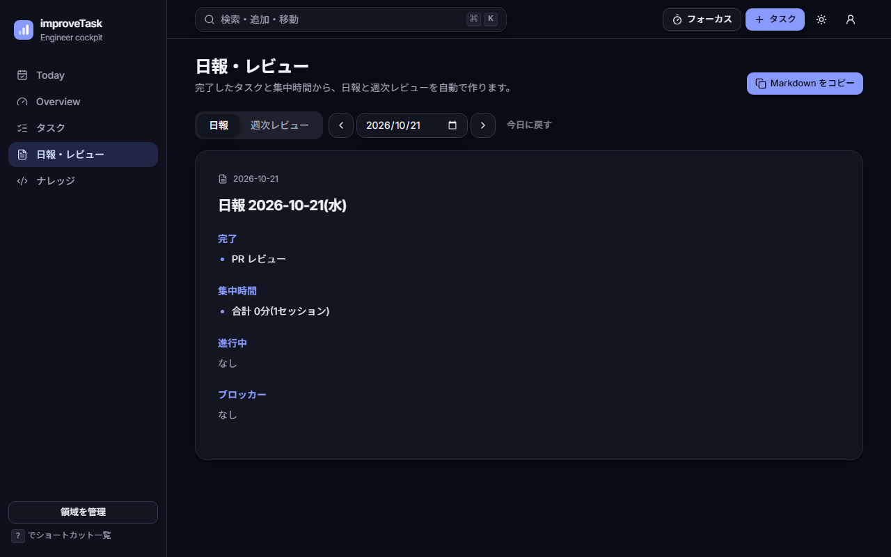

_図 4-9: ダークテーマ。色・余白・角丸・影はトークン(CSS 変数)で定義し、両テーマで同じ構造を使う。_

---

## 5. 横断機能の仕様

### 5-1. コマンドパレット(`⌘/Ctrl + K`)

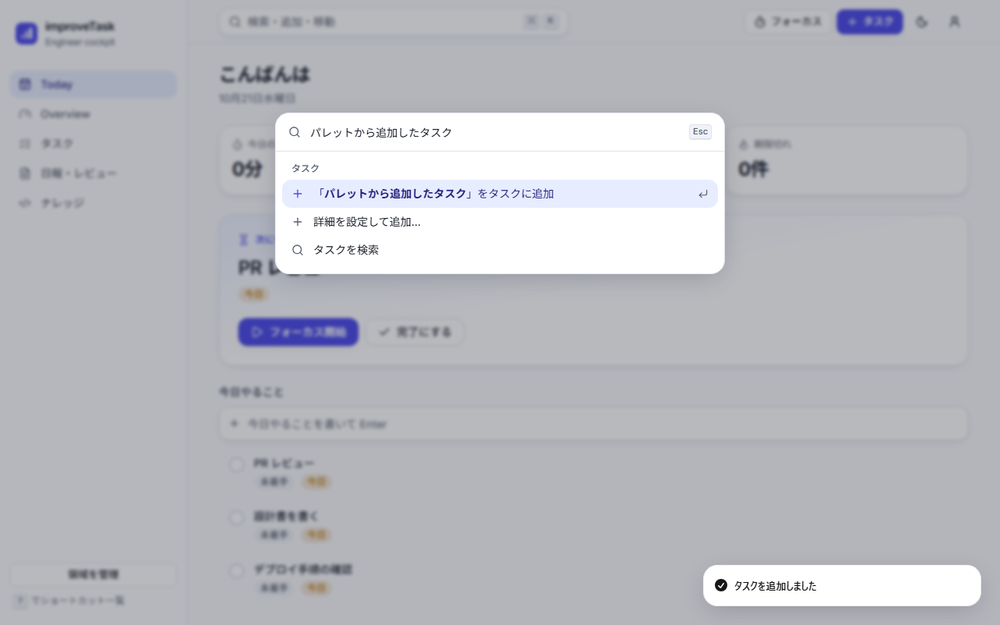

_図 5-1: 文字を入力すると、先頭に「タスクに追加」の候補が出る(↵ で追加)。_

| 入力     | 候補                                                                                                                               |
| -------- | ---------------------------------------------------------------------------------------------------------------------------------- |
| 文字あり | 「**「…」をタスクに追加**」(Enter で即追加)/「詳細を設定して追加…」(ダイアログ)/「タスクを検索」(`/tasks?q=…`)                     |
| 常に     | **移動**(5 画面)/ **操作**(新規タスク `C`、フォーカスの開始・終了 `F`、領域を管理、テーマ切替、ショートカット一覧 `?`、ログアウト) |

- 文字を入力したときだけ「見つかりませんでした」は出さない(追加候補が常にあるため)。
- Esc で閉じる。

### 5-2. キーボードショートカット

入力欄を操作していないときに使える。**修飾キー付き、またはダイアログが開いている間は無効**(`⌘/Ctrl + K` を除く)。

| キー                           | 動作                                                                   |
| ------------------------------ | ---------------------------------------------------------------------- |
| `⌘/Ctrl + K`                   | コマンドパレットを開く/閉じる                                          |
| `C`                            | タスクをすばやく追加(ダイアログ)                                       |
| `F`                            | フォーカスの開始(ダイアログ)/ 終了                                     |
| `?`                            | ショートカット一覧                                                     |
| `G` のあと `T` `O` `A` `R` `S` | Today / Overview / タスク / 日報 / ナレッジへ移動(`G` から 1.2 秒以内) |
| `⌘/Ctrl + Enter`               | フォームの送信(タスク・ナレッジ)                                       |

### 5-3. タスクの作成・編集ダイアログ

| 項目     | 仕様                                                                               |
| -------- | ---------------------------------------------------------------------------------- |
| タイトル | 必須、1〜200 文字(前後の空白は除く)                                                |
| 領域     | 未分類、または既存の領域                                                           |
| 状態     | **編集時のみ**表示(未着手 / 進行中 / ブロック中 / 完了)。新規は未着手              |
| 期限     | 日付を選ぶと**その日の 23:59(ローカル時刻)**になる                                 |
| 優先度   | 低(0)/ 中(1)/ 高(2)/ 緊急(3)。既定は中                                             |
| 見積もり | 1〜1440 分                                                                         |
| タグ     | カンマ・空白・読点で区切る。`#` は無視。重複は除く。**最大 10 個、各 30 文字まで** |
| メモ     | 最大 5000 文字                                                                     |

- 入力はクライアントとサーバーの**両方で同じ zod スキーマ**で検証する(`packages/shared`)。エラーは、ダイアログ内に表示する。
- 保存に成功したら、通知を出して閉じる。

### 5-4. フォーカス(ポモドーロ)

| 項目                 | 仕様                                                                                                                                   |
| -------------------- | -------------------------------------------------------------------------------------------------------------------------------------- |
| 開始ダイアログ       | タスク(任意。未完了のタスクから選ぶ)と時間を選ぶ。時間は「25 分」「50 分」(集中)、「休憩 5 分」「休憩 15 分」                          |
| 計測中の表示         | ヘッダーに**残り時間(`MM:SS`)と終了ボタン**。経過に応じて背景が伸びる。タブのタイトルにも残り時間(集中は `●`、休憩は `☕`)             |
| Today                | 「次にやること」の代わりに、**大きなリングタイマー**、タスク名、経過/予定、「終了して記録」                                            |
| 予定時間に達したとき | 一度だけ通知。計測は止まらず、残り時間は負の値(`-MM:SS`)に。ヘッダーの表示は緑                                                         |
| 終了                 | 経過秒数(`durationSec`)を記録し、「お疲れさまでした。記録しました」を通知                                                              |
| 制約                 | **同時に計測できるセッションは 1 つ**。計測中にもう一度開始しようとすると、409(「進行中のセッションがあります。先に終了してください」) |

### 5-5. 領域の管理

| 項目 | 仕様                                                                                                                         |
| ---- | ---------------------------------------------------------------------------------------------------------------------------- |
| 一覧 | 色(カラーピッカー)と名前。フォーカスが外れたときに保存                                                                       |
| 追加 | 名前(1〜50 文字)。色は 8 色(`#6366f1` `#0ea5e9` `#10b981` `#f59e0b` `#ef4444` `#ec4899` `#8b5cf6` `#64748b`)から順に割り当て |
| 重複 | 同じ名前は**ユーザーごとに**不可(409)                                                                                        |
| 削除 | 確認のあと削除。**タスクは削除されず「未分類」になる**                                                                       |

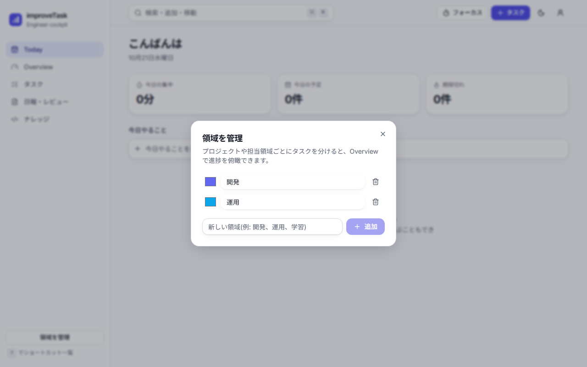

_図 5-5: 領域を管理ダイアログ。_

### 5-6. 通知(トースト)

- 画面右下に表示。成功・失敗の結果と、「元に戻す」(完了時)を出す。
- エラーは、サーバーの統一エラー形式のメッセージをそのまま表示する。

### 5-7. 楽観的更新

タスクの作成・更新・削除・並べ替えは、**サーバーの応答を待たずに画面へ反映**し、失敗したら元に戻す(ロールバック)。完了後に、関連する一覧・Overview・日報を再取得して整合を取る。

---

## 6. データモデル

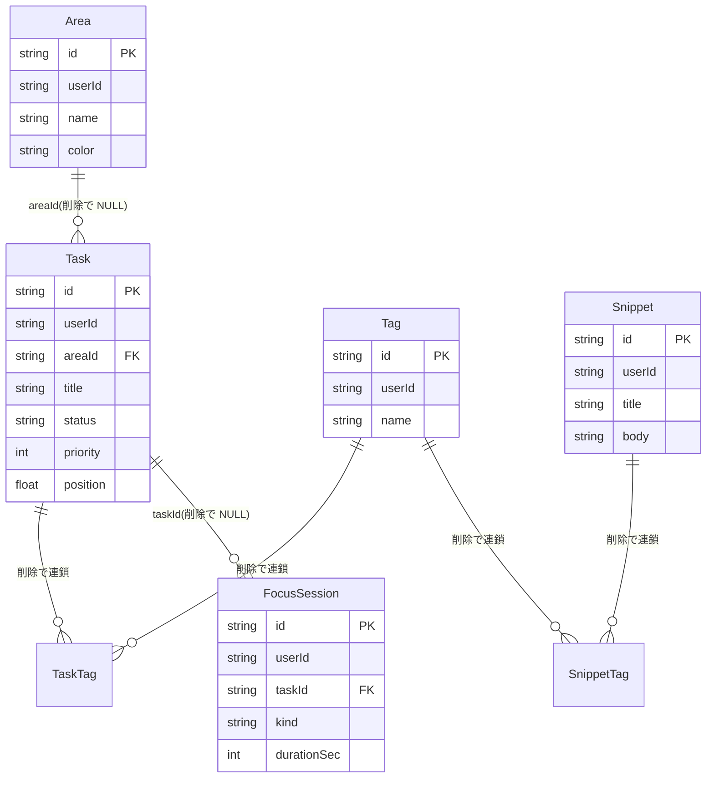

### 6-1. テーブル定義

すべて `userId`(Supabase Auth のユーザー ID、文字列)を持つ。**外部キーは張らず**、リポジトリ層で全クエリに条件を付ける。ID は `cuid`。

| テーブル       | 主な列(型 / 既定)                                                                                                                                         | 制約・索引                                                     |
| -------------- | --------------------------------------------------------------------------------------------------------------------------------------------------------- | -------------------------------------------------------------- |
| `Area`         | `name` / `color`(`#6366f1`)/ `createdAt` / `updatedAt`                                                                                                    | `(userId, name)` 一意                                          |
| `Task`         | `areaId?` / `title` / `notes?` / `status`(`todo`)/ `priority`(1)/ `estimateMin?` / `dueDate?` / `position`(0)/ `completedAt?` / `createdAt` / `updatedAt` | 索引 `(userId, status)` `(userId, dueDate)` `(userId, areaId)` |
| `Tag`          | `name`                                                                                                                                                    | `(userId, name)` 一意                                          |
| `TaskTag`      | `taskId` / `tagId`                                                                                                                                        | 主キー `(taskId, tagId)`。`userId` を持たない                  |
| `FocusSession` | `taskId?` / `kind`(`focus`)/ `plannedSec`(1500)/ `startedAt` / `endedAt?` / `durationSec`(0)                                                              | 索引 `(userId, startedAt)` `(taskId)`                          |
| `Snippet`      | `title` / `body` / `language?` / `createdAt` / `updatedAt`                                                                                                | 索引 `(userId, updatedAt)`                                     |
| `SnippetTag`   | `snippetId` / `tagId`                                                                                                                                     | 主キー `(snippetId, tagId)`。`userId` を持たない               |

### 6-2. 値の取り方

| 列                  | 取り得る値                            | 備考                                                               |
| ------------------- | ------------------------------------- | ------------------------------------------------------------------ |
| `Task.status`       | `todo` / `doing` / `blocked` / `done` | DB の enum は使わず、zod で検証(SQLite と Postgres の両対応のため) |
| `Task.priority`     | 0(低)〜 3(緊急)                       |                                                                    |
| `FocusSession.kind` | `focus` / `break`                     |                                                                    |
| 日時                | ISO 8601 文字列(API)/ DateTime(DB)    |                                                                    |

### 6-3. 削除したときの連鎖

| 削除するもの | 影響                                                                           |
| ------------ | ------------------------------------------------------------------------------ |
| 領域         | その領域のタスクは**残り**、`areaId` が空(未分類)になる                        |
| タスク       | `TaskTag` を削除。`FocusSession` は残り、`taskId` が空になる(時間の記録は保持) |
| タグ         | `TaskTag` と `SnippetTag` を削除(タスク・スニペット自体は残る)                 |
| スニペット   | `SnippetTag` を削除                                                            |

### 6-4. DB の種類による扱いの違い

- 開発は SQLite、本番は Supabase Postgres。**両方で動く型だけ**を使う(enum・配列・Json は使わない)。
- マイグレーションは種類ごとに分ける(`prisma/migrations/sqlite` と `prisma/migrations/postgres`)。
- 本番(Postgres)には、**RLS を有効化し、`anon` / `authenticated` の権限を剥奪する**マイグレーションを適用している(9 章)。

---

## 7. API 仕様

- ベースパスは `/api`。**画面と同じ Vercel プロジェクト**で動く(Hono)。
- 認証は `Authorization: Bearer <JWT>`。ブラウザからは、Cookie のセッションから、サーバー側が付け替える。
- 日時は ISO 8601(オフセット付き)。`DELETE` は本文なしの `204`。

### 7-1. エンドポイント

| メソッド・パス             | 認証 | 内容                                | 成功時              |
| -------------------------- | ---- | ----------------------------------- | ------------------- |
| `GET /api/health`          | 不要 | 死活監視                            | `200 {"ok":true}`   |
| `GET /api/health/db`       | 不要 | DB との疎通確認(`select 1`)         | `200`、失敗は `503` |
| `GET /api/areas`           | 必要 | 領域の一覧(作成が古い順)            | `200`               |
| `POST /api/areas`          | 必要 | 領域の作成                          | `201`               |
| `PATCH /api/areas/:id`     | 必要 | 領域の更新                          | `200`               |
| `DELETE /api/areas/:id`    | 必要 | 領域の削除                          | `204`               |
| `GET /api/tasks`           | 必要 | タスクの一覧(クエリで絞り込み)      | `200`               |
| `POST /api/tasks`          | 必要 | タスクの作成                        | `201`               |
| `GET /api/tasks/:id`       | 必要 | タスクの取得                        | `200`               |
| `PATCH /api/tasks/:id`     | 必要 | タスクの更新                        | `200`               |
| `DELETE /api/tasks/:id`    | 必要 | タスクの削除                        | `204`               |
| `GET /api/focus/active`    | 必要 | 計測中のセッション(無ければ `null`) | `200`               |
| `POST /api/focus/start`    | 必要 | 計測の開始                          | `201`               |
| `POST /api/focus/:id/stop` | 必要 | 計測の終了                          | `200`               |
| `GET /api/snippets`        | 必要 | スニペットの一覧(`q`・`tag`)        | `200`               |
| `POST /api/snippets`       | 必要 | スニペットの作成                    | `201`               |
| `GET /api/snippets/:id`    | 必要 | スニペットの取得                    | `200`               |
| `PATCH /api/snippets/:id`  | 必要 | スニペットの更新                    | `200`               |
| `DELETE /api/snippets/:id` | 必要 | スニペットの削除                    | `204`               |
| `GET /api/overview`        | 必要 | Overview の集計                     | `200`               |
| `GET /api/reports`         | 必要 | 日報・週次レビュー(`type`・`date`)  | `200`               |

### 7-2. タスク一覧のクエリ

| パラメーター | 値                              | 意味                    |
| ------------ | ------------------------------- | ----------------------- |
| `status`     | `todo` `doing` `blocked` `done` | 状態で絞る              |
| `areaId`     | 領域の ID                       | 領域で絞る              |
| `tag`        | タグ名                          | タグで絞る              |
| `due`        | `overdue` `today` `week`        | 期限で絞る(定義は 8 章) |
| `q`          | 1〜100 文字                     | タイトルに含まれる語    |
| `limit`      | 1〜200(既定 100)                | 取得件数                |

並びは、`position` の昇順、同じなら作成が新しい順。

### 7-3. 入力の制限(zod)

| 対象       | 項目          | 制限                         |
| ---------- | ------------- | ---------------------------- |
| 領域       | `name`        | 1〜50 文字(前後の空白は除く) |
|            | `color`       | `#RRGGBB`                    |
| タスク     | `title`       | 1〜200 文字                  |
|            | `notes`       | 〜5000 文字                  |
|            | `priority`    | 整数 0〜3                    |
|            | `estimateMin` | 整数 1〜1440                 |
|            | `dueDate`     | ISO 8601(オフセット付き)     |
|            | `tags`        | 最大 10 個、各 1〜30 文字    |
| フォーカス | `plannedSec`  | 整数 60〜14400(既定 1500)    |
| スニペット | `title`       | 1〜120 文字                  |
|            | `body`        | 1〜20000 文字                |
|            | `language`    | 〜30 文字                    |
| 日報       | `type`        | `daily` または `weekly`      |
|            | `date`        | `YYYY-MM-DD`(省略時は今日)   |

更新(`PATCH`)は、**指定した項目だけ**を変える。`null` を渡すと値を消し、省略すると変更しない。

### 7-4. エラー形式

すべてのエラーは次の形に統一する。

```json
{ "error": { "code": "not_found", "message": "見つかりません" } }
```

| ステータス | `code`                  | 発生する場面                                                  |
| ---------- | ----------------------- | ------------------------------------------------------------- |
| 400        | `validation_error`      | 入力が不正、不正な JSON、他のユーザーの領域・タスクを参照した |
| 401        | `unauthorized`          | トークンが無い・無効                                          |
| 404        | `not_found`             | 対象が無い、または**他のユーザーのもの**(存在を区別しない)    |
| 409        | `conflict`              | 領域名の重複、計測中のセッションがあるのに開始しようとした    |
| 500        | `internal_error`        | 想定外のエラー(詳細は返さない)                                |
| 503        | (`/api/health/db` のみ) | DB に接続できない                                             |

### 7-5. `/api/health/db` の応答

| 状況             | 応答                                                                                                                           |
| ---------------- | ------------------------------------------------------------------------------------------------------------------------------ |
| 成功             | `200 {"ok":true,"db":"up","target":"postgres"}`                                                                                |
| 失敗(本番)       | `503 {"ok":false,"db":"down","target":"postgres"}`。**接続情報や詳細なエラーは返さない**                                       |
| 失敗(開発中のみ) | 上に加えて `connection`(ユーザー名・ホスト・ポート・DB 名、パスワードの**文字数**など)を返す。**パスワードそのものは返さない** |

---

## 8. 業務ルールと計算定義

### 8-1. タイムゾーンと「今日」「今週」

- 「今日」「今週」の境界は、環境変数 `APP_TZ_OFFSET_MIN`(分)の**固定オフセット**で決める(日本は `540`)。未設定は UTC。
- **週は月曜始まり**。夏時間のあるタイムゾーンは未対応。

| `due` の値 | 意味                                           |
| ---------- | ---------------------------------------------- |
| `overdue`  | 期限が現在より前で、**完了していない**         |
| `today`    | 期限が今日の 0:00 以上、翌日の 0:00 未満       |
| `week`     | 期限が今週(月曜 0:00 以上、翌週月曜 0:00 未満) |

### 8-2. タスクの状態と完了日時

- 状態を `done` にすると `completedAt` に現在時刻を入れ、`done` 以外にすると `completedAt` を空にする。
- 新規作成時に `done` を指定した場合も、`completedAt` を入れる。
- 新規タスクの並び順は、**既存の最大値 + 1024**(末尾)。

### 8-3. フォーカスの記録

- 開始時に `startedAt` を記録し、終了時に `endedAt` と `durationSec`(経過秒、四捨五入、0 未満は 0)を記録する。
- 集計では、`kind = focus` のセッションだけを数える(休憩は含めない)。**分に換算するときは四捨五入**するので、30 秒未満のセッションは 0 分として表示される。

### 8-4. Overview の集計

| 項目           | 定義                                                                                     |
| -------------- | ---------------------------------------------------------------------------------------- |
| 領域別の件数   | 全体 / 完了 / 進行中 / ブロック中 / 期限切れ(未着手 = 全体 − 完了 − 進行中 − ブロック中) |
| 今週の計画(分) | 今週が期限の**未完了**タスクの見積もりの合計(見積もりが無いものは 0)                     |
| 今週の集中(分) | 今週に開始した集中セッションの `durationSec` の合計                                      |
| 期限切れ件数   | 期限を過ぎた未完了タスクの数                                                             |
| ブロック中件数 | 状態が `blocked` のタスクの数                                                            |
| 集中時間の推移 | 今日を含む直近 7 日の、日別の集中時間(分)                                                |

### 8-5. 日報・週次レビューの対象

| 項目       | 日報                   | 週次レビュー                  |
| ---------- | ---------------------- | ----------------------------- |
| 期間       | 指定日の 1 日          | 指定日を含む週(月〜日)        |
| 完了       | 期間内に完了したタスク | 同左                          |
| 集中時間   | 期間内の集中セッション | 同左(日別も出す)              |
| 進行中     | 現在の進行中           | (載せない)                    |
| 来週が期限 | (載せない)             | 期間の直後 7 日が期限の未完了 |
| 期限切れ   | (載せない)             | 現在の期限切れ                |
| ブロッカー | 現在のブロック中       | 同左                          |

---

## 9. 認証・認可・セキュリティ

### 9-1. 多層の防御

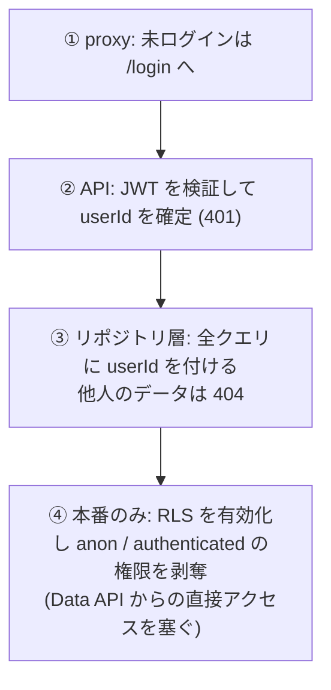

| 層             | 内容                                                                                                                                               |
| -------------- | -------------------------------------------------------------------------------------------------------------------------------------------------- |
| ① proxy        | Supabase のセッションを更新し、未ログインの画面アクセスを `/login` へ。`/login`、`/auth/*`、`/api/*` は対象外(API は自分で 401 を返す)             |
| ② API の認証   | `Authorization` の JWT を `getClaims()` で検証(非対称鍵なら JWKS でローカル検証)。`userId` をリクエストに載せる                                    |
| ③ リポジトリ層 | `userId` を**生成時に束縛**するので、呼び出し側が渡し忘れられない。更新・削除も `where: { id, userId }`。他人の ID は「存在しない」と同じ扱い(404) |
| ④ RLS(本番)    | アプリは Prisma(オーナー権限)で接続するため RLS をバイパスする。④は、**Supabase の Data API 経由の直接アクセス**を塞ぐための多層防御               |

- 参照先(領域・タスク)も、**自分のものだけ**を指定できる(他人のものは 400)。
- 他のユーザーのデータにアクセスできないことは、統合テストで確認している(11 章)。

### 9-2. 認証の仕組み

- Supabase Auth(メール + パスワード)。パスワードの保管や検証は Supabase が行い、このアプリは持たない。
- セッションは **Cookie**(`@supabase/ssr`)。ブラウザは Cookie でログイン状態を持ち、`/api` のハンドラーが Cookie から取り出したトークンを `Authorization` に付け替えて Hono へ渡す。
- Server Component は Cookie を書けないため、トークンの更新は proxy が担当する。

### 9-3. 秘密情報の扱い

- `.env*`(`.env.example` を除く)は git に入れない。CI にも置かない。
- ブラウザに公開してよいのは `NEXT_PUBLIC_` の変数だけ(公開用キー)。`service_role` キーは使わない。
- DB の接続文字列は、Vercel では **Sensitive** にし、チャットや Issue に貼らない。
- 開発時の診断(`/api/health/db` の接続先情報)は、`NODE_ENV=production` では出さない。

---

## 10. 非機能要件

| 分類             | 内容                                                                                                                                              |
| ---------------- | ------------------------------------------------------------------------------------------------------------------------------------------------- |
| アクセシビリティ | コントラスト AA 以上を目標。フォーカスリング。ダイアログ・タブ・チェックボックスに適切な ARIA。スキップリンク。グラフには表での代替(「表で見る」) |
| キーボード操作   | 主要な操作にショートカット(5-2)。コマンドパレットから大半の操作に到達できる                                                                       |
| レスポンシブ     | PC(サイドバー)とモバイル(下部ナビ)。幅 390px で横スクロールなし                                                                                   |
| テーマ           | ライト/ダーク。OS の設定に追従。トークンで定義                                                                                                    |
| モーション       | 控えめ。`prefers-reduced-motion` を尊重(アニメーションをほぼ無効化)                                                                               |
| 応答性           | 楽観的更新。取得結果は 30 秒間は新しいものとして扱い、失敗時は 1 回再試行(TanStack Query)                                                         |
| 言語             | UI は日本語。コードの識別子・技術用語は原文                                                                                                       |
| 配信             | Vercel のサーバーレス。本番は必ず Postgres(SQLite は使えない)                                                                                     |

---

## 11. テストと品質

| 種類                     | 内容                                                                                                                                                                                    | 実行                                             |
| ------------------------ | --------------------------------------------------------------------------------------------------------------------------------------------------------------------------------------- | ------------------------------------------------ |
| ユニット・統合(Vitest)   | 10 ファイル・76 件(2026-10-22 時点)。契約(zod)、日付、DB のスキーマ制約、リポジトリ、**認可(他ユーザーは 404)**、API 全体、画面のロジック(並べ替え・期限表示など)。DB は一時的な SQLite | `pnpm test`                                      |
| E2E スモーク(Playwright) | 5 件。`/api/health`、未ログインの API が 401、未ログインの画面が `/login` へ 307、ログイン画面の表示と切り替え。**秘密情報なしで動く**                                                  | `pnpm test:e2e`                                  |
| E2E 通し(Playwright)     | ログイン → タスク追加 → 完了 → フォーカス → 日報。**テスト用アカウントを渡したときだけ動く**(CI ではスキップ)                                                                           | `E2E_EMAIL=… E2E_PASSWORD=… pnpm test:e2e`       |
| 静的検査                 | 型チェック(TypeScript strict)、ESLint、Prettier                                                                                                                                         | `pnpm typecheck` `pnpm lint` `pnpm format:check` |

**CI(GitHub Actions)**: `main` / `develop` への push と、同ブランチ宛ての PR で、次を順に実行する。

1. `pnpm install --frozen-lockfile`
2. `pnpm db:gen`(Prisma クライアントの生成)
3. `next build`(ダミーの環境変数で)
4. `pnpm typecheck` → `pnpm lint` → `pnpm test`
5. Playwright のインストール → `pnpm test:e2e`(スモークのみ)

---

## 12. 付録(キャプチャ)

### 12-1. 撮影条件

| 項目       | 内容                                                                                                       |
| ---------- | ---------------------------------------------------------------------------------------------------------- |
| ツール     | Playwright(Chrome、ヘッドレス)                                                                             |
| 対象       | **本番ビルド**(`next build` → `next start`)。開発用バッジが写らない                                        |
| 画面サイズ | PC 1280×800 / モバイル 390×844                                                                             |
| ロケール   | `ja-JP`、タイムゾーン `Asia/Tokyo`                                                                         |
| データ     | **テスト用のサンプル**(撮影用のアカウントと、数件のタスク・領域・ナレッジ)。画面の日付は撮影日の **10/21** |
| 注意       | 一部は、通知や遷移の途中で撮影している。サンプルの集中時間が数秒のため、Overview のグラフは 0 分           |

### 12-2. キャプチャ一覧

| ファイル                                                  | 画面                         | 掲載箇所 |
| --------------------------------------------------------- | ---------------------------- | -------- |
| [login.png](images/login.png)                             | ログイン                     | 4-2      |
| [today.png](images/today.png)                             | Today(データあり)            | 4-3      |
| [today-empty.png](images/today-empty.png)                 | Today(空の状態)              | 4-3      |
| [overview.png](images/overview.png)                       | Overview                     | 4-4      |
| [tasks.png](images/tasks.png)                             | タスク一覧                   | 4-5      |
| [tasks-focus-running.png](images/tasks-focus-running.png) | タスク一覧(計測中・行の操作) | 4-1      |
| [report-daily.png](images/report-daily.png)               | 日報                         | 4-6      |
| [report-weekly.png](images/report-weekly.png)             | 週次レビュー                 | 4-6      |
| [snippets-list.png](images/snippets-list.png)             | ナレッジ一覧                 | 4-7      |
| [snippet-dialog.png](images/snippet-dialog.png)           | ナレッジの追加ダイアログ     | 4-7      |
| [palette.png](images/palette.png)                         | コマンドパレット             | 5-1      |
| [areas-dialog.png](images/areas-dialog.png)               | 領域を管理                   | 5-5      |
| [mobile-today.png](images/mobile-today.png)               | モバイルの Today             | 4-8      |
| [mobile-tasks.png](images/mobile-tasks.png)               | モバイルのタスク             | 4-8      |
| [mobile-overview.png](images/mobile-overview.png)         | モバイルの Overview          | 4-8      |
| [dark-today.png](images/dark-today.png)                   | ダークテーマの Today         | 4-9      |
| [dark-tasks.png](images/dark-tasks.png)                   | ダークテーマのタスク         | 4-5      |
| [dark-report-daily.png](images/dark-report-daily.png)     | ダークテーマの日報           | 4-9      |

### 12-3. 未撮影の画面

次の画面は、**キャプチャを取得できていない**。仕様は本文の文章で記述している。

| 画面                                                     | 仕様の記載箇所 |
| -------------------------------------------------------- | -------------- |
| タスクの追加・編集ダイアログ                             | 5-3            |
| フォーカス開始ダイアログ                                 | 5-4            |
| Today のフォーカスパネル(大きなリングタイマー)           | 4-3、5-4       |
| 完了の通知(「元に戻す」付き)                             | 4-5、5-6       |
| ショートカット一覧(本番ビルドの画像)                     | 5-2            |
| アカウントメニュー                                       | 4-1            |
| ログインのエラー表示、「確認メールを送信しました」       | 4-2            |
| 読み込み中(スケルトン)、取得失敗、各画面の空の状態の一部 | 4 章各節       |

> 撮り直すには、認証済みの状態とサンプルデータが必要。ローカルで動かす場合は、一時的な SQLite にデータを入れ、認証は偽の Supabase(公開鍵を返すだけのサーバー)に差し替える方法がある。本番の DB には書き込まない。

---

## 13. 既知の制約・未対応

| 区分           | 内容                                                                                                                                                |
| -------------- | --------------------------------------------------------------------------------------------------------------------------------------------------- |
| デプロイ       | **Vercel 上でのビルドと実行は、本書の作成時点では確認していない**(`vercel.json` のコマンド、モノレポの取り込み設定)                                 |
| DB             | Postgres に対する自動テストは無い(統合テストは SQLite のみ)。本番 Postgres での動作は、接続とタスクの追加を手動で確認済み(完了・削除などは実施予定) |
| 検索           | 大文字小文字の扱いが DB で異なる(SQLite は ASCII を区別しない、Postgres は区別する)                                                                 |
| タイムゾーン   | 固定オフセットのみ。夏時間は未対応。ユーザーごとの設定は無い                                                                                        |
| 件数           | ページ送りは無い(タスクは最大 200 件、ナレッジは 200 件まで表示)                                                                                    |
| 認証           | パスワードの再設定、外部アカウント(GitHub など)でのログイン、アカウントの削除の画面は無い                                                           |
| メール         | 標準のメール送信は 1 時間に数通まで。公開するなら SMTP の設定が必要                                                                                 |
| オフライン     | 非対応(PWA 化は拡張案)                                                                                                                              |
| 集中時間の表示 | 分に四捨五入するため、30 秒未満のセッションは 0 分と表示される                                                                                      |
| 共有           | チームでの共有、他ユーザーとのデータ共有の機能は無い                                                                                                |

拡張案は [roadmap.md](roadmap.md) を参照。
